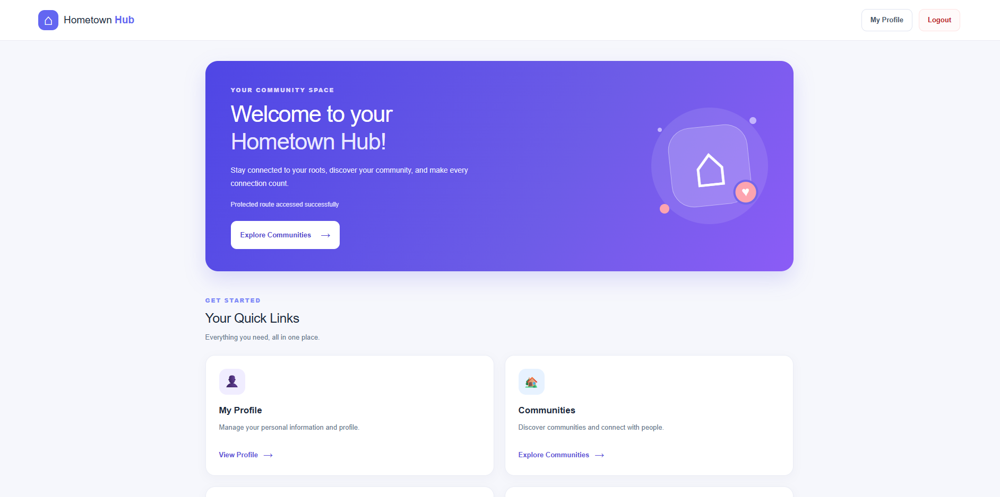
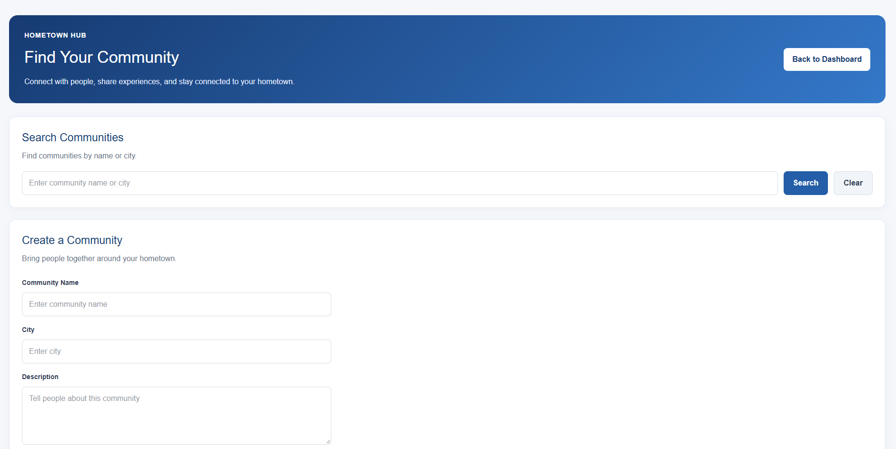
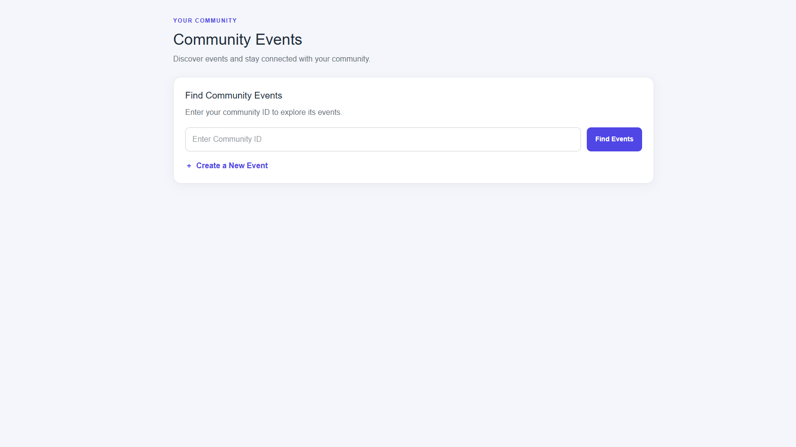
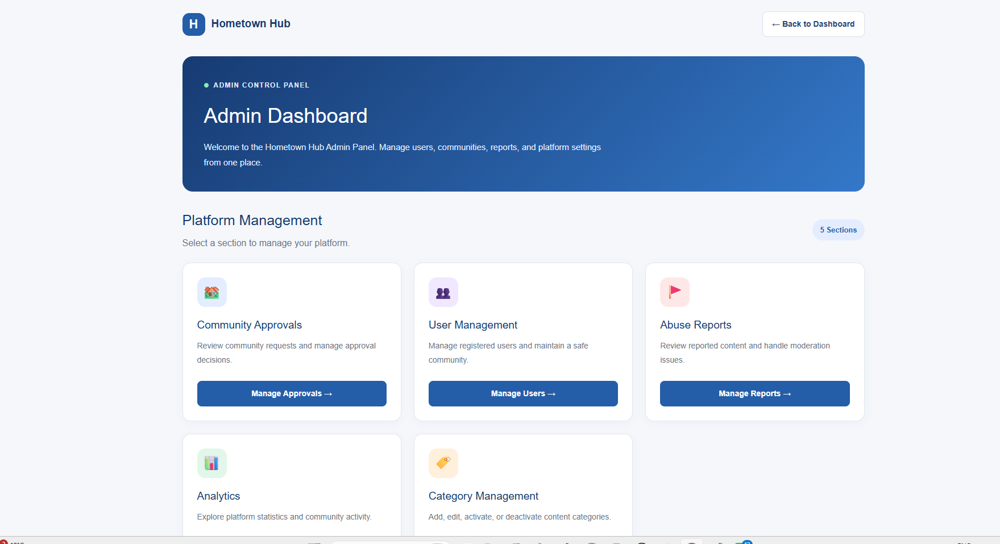
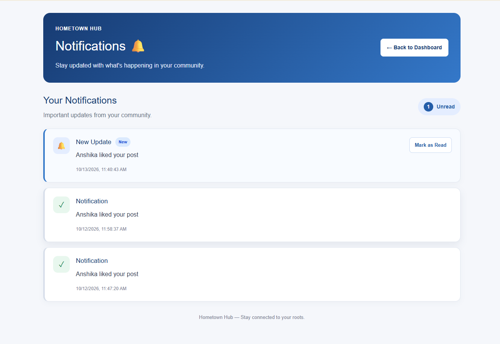
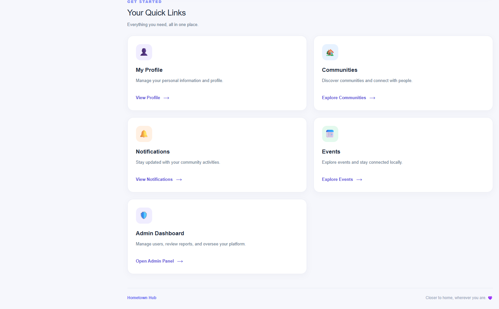

# Hometown Hub – Digital Community Platform

Hometown Hub is a digital community platform that connects people with their hometown communities. Users can create profiles, join communities, share posts, participate in events, receive notifications, and communicate through real-time chat.

## Live Demo

- **Frontend:** https://hometown-hub-one.vercel.app
- **Backend:** https://hometown-hub-backend-lktf.onrender.com
- **GitHub Repository:** https://github.com/anshikaa052-prog/Hometown-Hub

> **Note:** The backend is hosted on Render. The first request may take around 1 minute while the server starts.

## Screenshots

### Home / Feed


### Communities


### Events


### Admin Dashboard


### Notifications


### User Profile


## Features

### User Features
- User registration and login
- Secure authentication
- User profile management
- Create, view, and interact with posts
- Like and comment on posts
- Join and explore communities
- Participate in community events
- Real-time notifications
- Real-time chat

### Admin Features
- Admin dashboard
- User management
- Block and unblock users
- Community approval management
- Report moderation
- Analytics and platform statistics

## Technology Stack

### Frontend
- React.js
- JavaScript
- HTML5
- CSS3
- Vite

### Backend
- Node.js
- Express.js
- Socket.IO

### Database
- MongoDB
- Mongoose

### Tools & Deployment
- Git
- GitHub
- Vercel
- Render
- Cloudinary

## Project Structure

```text
Hometown-Hub/
│
├── client/
│   ├── src/
│   ├── public/
│   └── package.json
│
├── server/
│   ├── controllers/
│   ├── models/
│   ├── routes/
│   ├── middleware/
│   ├── config/
│   └── package.json
│
├── screenshots/
│   ├── home.png
│   ├── community.png
│   ├── events.png
│   ├── admin-dashboard.png
│   ├── notifications.png
│   └── profile.png
│
├── .gitignore
└── README.md
```

## Installation and Setup

### 1. Clone the Repository

```bash
git clone https://github.com/anshikaa052-prog/Hometown-Hub.git
cd Hometown-Hub
```

### 2. Backend Setup

```bash
cd server
npm install
```

Create a `.env` file inside the server folder and configure:

```env
PORT=5000
MONGO_URI=your_mongodb_connection_string
JWT_SECRET=your_jwt_secret
CLIENT_URL=http://localhost:5173

CLOUDINARY_CLOUD_NAME=your_cloudinary_cloud_name
CLOUDINARY_API_KEY=your_cloudinary_api_key
CLOUDINARY_API_SECRET=your_cloudinary_api_secret
```

Start the backend:

```bash
npm run dev
```

### 3. Frontend Setup

Open another terminal:

```bash
cd client
npm install
```

Create a `.env` file inside the client folder:

```env
VITE_API_URL=http://localhost:5000/api
```

Start the frontend:

```bash
npm run dev
```

The application will run locally using the frontend and backend development servers.

## Environment Variables

Do not share or upload actual environment variable values, database credentials, API keys, or JWT secrets to GitHub.

## Demo Accounts

Demo account credentials are available on request.

Please contact the developer for testing access.

Only dedicated test accounts should be used.
Personal or production account credentials must never be shared.

## Deployment

- Frontend deployed on Vercel.
- Backend deployed on Render.
- Database hosted on MongoDB Atlas.
- Image uploads managed through Cloudinary.

## Developer

**Anshika Agarwal**

B.Tech – Computer Science and Engineering

GitHub: https://github.com/anshikaa052-prog

---

If you find this project useful, feel free to explore the repository.
